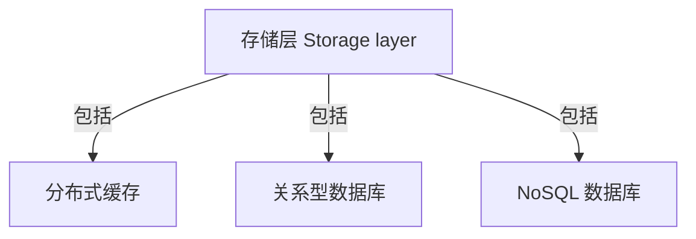

# 句意图 · TextLens

Windows 后台划词图解工具。选中文字 → 大模型解析概念与关系 → 实时生成 SVG → 在选区上方展示。不是网站，不启动本地 Web 服务，也不捆绑浏览器。

## 使用

1. 双击单文件版 `dist\TextLens.exe`；无需安装 Python，也不需要携带依赖文件夹。程序只驻留系统托盘，不显示主窗口，首次运行也不弹出设置。
2. 在任务栏右下角（图标可能在“显示隐藏的图标”中）右键句意图图标 →“设置…”，填写供应商名称、上游格式、API 请求地址、API Key 和模型 ID。
3. 点击“测试模型连接”，验证该模型能返回图解；测试会发送内置示例并产生一次 API 调用。
4. 勾选“启用自动划词图解”并保存。WPS PDF 等无法直接读取选区的阅读器，可另外勾选“PDF / 文档兼容划词”。以后拖动鼠标划词，或双击选择文字，图解浮窗会逐步显示。
5. 右键系统托盘图标可暂停、打开设置、查看本地示例或退出。关闭设置窗口不会退出后台程序。

设置仅由托盘右键菜单打开；单击或双击图标不会弹窗。重复启动也不会弹窗或启动第二个实例。配置读取失败、快捷键冲突等后台提示会保留到手动打开设置时显示，不在启动时打断操作。

浮窗优先出现在选区上方；上方空间不足时移到下方，始终限制在当前显示器工作区内。长图可滚动，标题栏可拖动，可导出 SVG。点击 × 会取消当前请求并隐藏浮窗。

### 快捷键与兼容性

- `Ctrl+Alt+I`：主动读取当前应用选区，不要求开启自动划词。
- `Ctrl+Alt+V`：主动图解已经复制的纯文本，不修改剪贴板。此操作也会向模型发送文本。
- 默认通过 Windows UI Automation 只读选区，不限浏览器；支持宿主窗口中的 PDF 子进程，跳过可识别的密码框。实际兼容性取决于应用是否提供选区接口。
- “PDF / 文档兼容划词”默认关闭，需在设置中主动启用。读取失败时，在 WPS、Adobe Reader、Foxit、SumatraPDF、PDF-XChange、Word、OneNote、记事本和主流浏览器等已知文档应用中临时模拟 Ctrl+C。其他应用仍可手动复制后按 Ctrl+Alt+V；不向终端模拟 Ctrl+C，以免中断命令。
- 兼容模式先备份可还原的文本/富文本格式，读取选区后还原；不恢复 OLE 内部指针。剪贴板包含无法安全备份的文件、图片或嵌入对象时跳过。若其他程序更新了剪贴板，不用旧内容覆盖它。超时或占用时不能保证还原；后台提示保留在设置中。
- 临时复制可能进入 Windows 剪贴板历史、云同步或被其他剪贴板工具观察到；还原当前剪贴板不能清除这些历史。启用前请确认可接受此行为。
- 图片型、扫描件或禁止复制的 PDF 不等于可选文本；本版本未内置 OCR。请先在阅读器中识别文字，或将可复制文本用 Ctrl+C → Ctrl+Alt+V 发送。兼容模式无法获得准确文字框时，浮窗锚定鼠标划词结束处。
- 高权限程序可能需要相同权限才能读取，受保护窗口或远程桌面不保证兼容；不建议为了划词长期以管理员身份运行。
- 双击、鼠标拖选属于自动触发范围；键盘选择后请使用手动快捷键。

### 首图加速

- 简单的“某层是……，包括 A、B、C”枚举句先本地生成预览，无需等待模型；浮窗明确标注“本地规则预览，尚未经 AI 核对”。不适用的句子不会套用模板编造图解。
- AI 在后台继续分析，Mermaid 返回第一条完整关系后逐步替换预览。若请求失败，保留标明来源的本地预览，不把它当作 AI 完成结果。
- 模型直接输出 Mermaid `flowchart TD/LR`，中文、英文选区均转换为中文图解并保留必要英文术语；不生成完整 SVG。仅处理已完整换行的语句，流式更新最多约每 120 毫秒提交一次，渲染器只保留最新待处理版本，最终结果始终提交。
- Mermaid.js 在后台隐藏的 WebView2 中提前加载、预热，不打开浏览器、不启动网站或监听 HTTP 端口，也不在运行时下载 CDN。先由 Mermaid.js 生成真实 SVG，再在同一渲染器内生成供原生 Tk 浮窗显示的 PNG 预览；导出仍是矢量 SVG，不是截图文件。
- 应用启动后的首次预热可能需要数秒，并增加后台内存占用；不是比原生绘图更轻的方案。预热期间本地规则预览仍能显示。相较直接让模型生成 SVG，Mermaid 通常能缩短输出；相较本程序原来的精简 JSON，并不保证更快。
- 同一文本的成功 AI 结果在内存中复用，最多 16 条、有效期 5 分钟；更换设置或退出程序即清除，不写入磁盘，不跨启动复用。
- 划词松开后的稳定等待从 180 毫秒缩短至 80 毫秒。浮窗的首图/完成用时从应用取得文本后计算，不包含操作系统选区读取时间。

本地枚举预览和命中缓存以接近即时显示为目标；任意新文本的完整 AI 图解无法承诺 1 秒。若上游首次返回已超过 1 秒，应用不能把等待压到 1 秒以内。请在供应商处确认模型、排队和响应速度；程序不会擅自替换配置的模型。

## 模型设置

支持三种可配置上游格式：

| 格式 | 根地址示例 | 自动补齐的路径 | 认证 |
| --- | --- | --- | --- |
| OpenAI Chat Completions | `https://your-provider.example/v1` | `/chat/completions` | Bearer API Key |
| OpenAI Responses | `https://your-provider.example/v1` | `/responses` | Bearer API Key |
| Anthropic Messages | `https://your-provider.example/v1` | `/messages` | x-api-key |

也可以填完整请求地址。地址中没有路径时自动使用 `/v1`。本机推理服务可用 `http://127.0.0.1:端口/v1`，无需认证时 API Key 可留空。远程请求必须使用 HTTPS，不跟随重定向。

模型须支持流式文本并遵循 Mermaid 格式；不需要图像生成能力。旧版逐行 JSON 图解协议不再用于模型输出。上游不流式时仍兼容普通 JSON API 响应，但图解须等待完整响应。模型内容示例：



目前仅接受矩形节点、箭头、关系标签和 TD/TB/LR 方向；不支持任意 Mermaid 图类型、子图、样式或交互语句。语法不符合要求会明确报错，不执行模型提供的 HTML、脚本或配置。

## 三层结构

1. `textlens/capture.py` + `clipboard_capture.py`：后台鼠标状态检测、跨进程 UI Automation 选区、密码框过滤，以及可选的文档复制兼容和剪贴板还原。
2. `textlens/model.py` + `mermaid.py`：上游请求、Mermaid 提示词、完整行增量解析、语法白名单和数量限制。
3. `renderer.py` + `assets/renderer.js`：预热的 Mermaid.js 本地渲染；`ui.py` + `tray.py` + `app.py`：原生浮窗、SVG 导出、托盘、快捷键、取消和过期结果隔离。`diagram.py` 仅保留本地规则预览、示例及旧结构测试。

Mermaid 使用 `securityLevel: strict`、纯 SVG 标签、禁止外联的内容安全策略。模型语句通过白名单后重新规范化，再交给 Mermaid；模型不能传入 SVG、HTML、脚本、链接、图片、配置或样式。最多 8 个节点、12 条关系。只有实际渲染成功的结果才进入内存缓存；关闭浮窗或重新划词后丢弃旧结果。

## 隐私

默认关闭自动发送和复制兼容；只有开启自动划词、触发手动快捷键或点击测试后才请求模型。设置窗口打开期间暂停自动捕获。程序不把划词内容和请求日志写入磁盘；成功图解有上述限时内存缓存，兼容复制的系统剪贴板历史风险另见上节。本地预览不联网，但触发图解后仍会请求 AI 更新（命中缓存除外）。API Key 使用 Windows DPAPI 绑定当前账户加密，设置保存在 `%APPDATA%\TextLens\settings.json`。供应商地址和模型 ID 是普通配置，不加密。选中内容仍会发送至配置的供应商，请自行确认服务方的数据政策。导出 SVG 是用户主动保存的文件，可能含原文信息。

## 源码运行与打包

需要 Windows 10/11、Python 3.11+（建议 64 位）及 Microsoft Edge WebView2 Runtime。程序复用系统 Runtime，不捆绑整套 Chromium；缺失时提示安装，不会静默下载。

```powershell
python -m pip install -r requirements.txt
python main.pyw
python main.pyw --demo
python selfcheck.py
python selfcheck.py --renderer
powershell -ExecutionPolicy Bypass -File .\build.ps1
```

日常启动直接双击 `dist\TextLens.exe`，可将此文件复制到桌面或其他目录；启动时不显示控制台，自动解压运行依赖可能需要几秒。配置仍保存在当前 Windows 账户的应用数据目录，不随 EXE 移动。源码运行也可双击 `main.pyw` 或使用 `pythonw main.pyw`。没有内置 API Key，也不自带模型。

`selfcheck.py --renderer` 使用内置测试文本验证真实 WebView2/Mermaid 渲染、SVG/PNG 输出和退出，并报告冷启动及预热后耗时，不调用模型或读取用户文档。Mermaid.js 固定为 11.12.2，来源 npm 官方 `mermaid` 包，随附许可见 `textlens/assets/MERMAID-LICENSE`。

EXE 的独立渲染自检：`dist\TextLens.exe --check-renderer build\renderer-check.json`（先确保输出目录存在）。该模式不读取用户设置、不启动划词、不调用模型或显示窗口，仅写入自检状态和时间。
